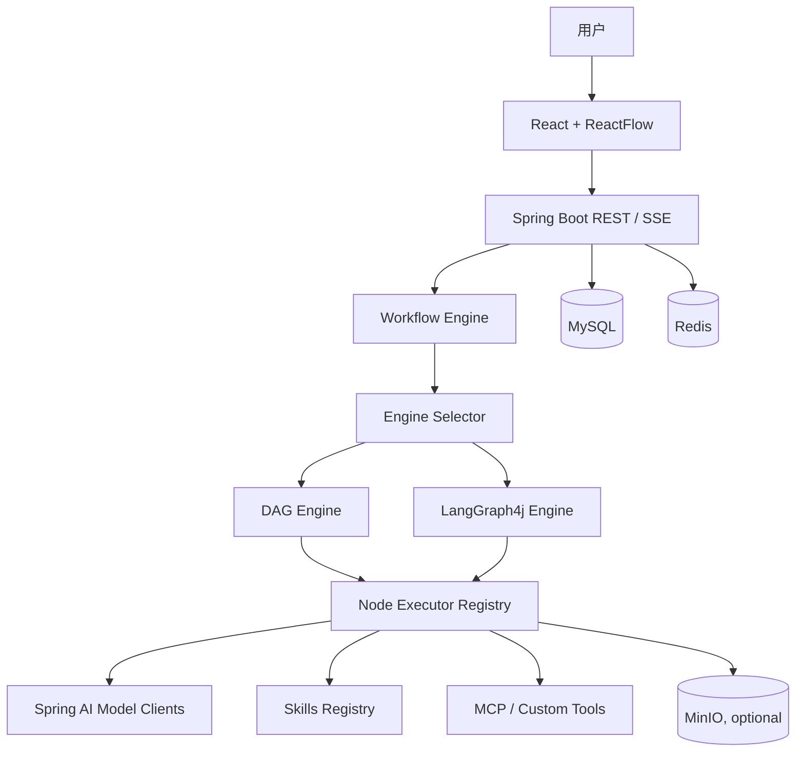

<div align="center">

# PaiAgent

**可视化 AI 工作流编排与 Agent 执行平台**

使用 ReactFlow 拖拽节点构建工作流，通过 DAG 或 LangGraph4j 引擎执行，并结合 Skills、模型适配和实时调试能力组织复杂 AI 任务。

</div>

<p align="center">
  
  
  
  
  
</p>

## 项目简介

PaiAgent 提供从工作流设计、节点配置到执行调试的一体化界面。用户可以在画布中组合输入、模型和工具节点，配置节点参数与数据流，再通过执行日志和 SSE 事件观察工作流运行情况。

项目重点在于工作流编排和 Agent 工程实践：将可视化编辑器、执行引擎、模型接入、Skills 加载和工具扩展组织成可演进的系统。

## 核心能力

| 模块 | 能力 |
| --- | --- |
| 可视化编辑器 | 基于 ReactFlow 的节点拖拽、连线、参数配置与流程调试 |
| DAG 引擎 | 拓扑排序、依赖调度、循环检测和节点结果传递 |
| LangGraph4j | StateGraph 状态管理、条件分支、动态路由和异步节点适配 |
| 双引擎路由 | 根据工作流配置选择 DAG 或 LangGraph4j 执行路径 |
| 模型接入 | 通过 Spring AI / Spring AI Alibaba 统一接入兼容模型服务 |
| Skills | 通过 SKILL.md 定义技能，支持摘要、详情和引用文档的渐进式加载 |
| 工具与节点扩展 | 自定义节点执行器、MCP 工具配置及知识库相关能力 |
| 实时调试 | REST API、SSE 执行事件、运行日志与结果记录 |

## 系统架构



## 技术栈

- **后端：** Java 21、Spring Boot 3.4.1、Maven、MyBatis-Plus
- **Agent / Workflow：** Spring AI、Spring AI Alibaba、LangGraph4j、自研 DAG 执行器
- **前端：** React 18、TypeScript、Vite、ReactFlow、Ant Design、Zustand
- **数据与存储：** MySQL、Redis、MinIO（可选）
- **接口：** REST API、SSE

## 快速开始

### 环境要求

- JDK 21
- Maven 3.8+
- Node.js 与 npm
- MySQL（必需）
- Redis、MinIO 按实际启用的功能配置

### 1. 初始化数据库

在仓库根目录执行：

```bash
mysql -u root -p -e "CREATE DATABASE paiagent DEFAULT CHARACTER SET utf8mb4 COLLATE utf8mb4_unicode_ci;"
mysql -u root -p paiagent < backend/src/main/resources/schema.sql
```

### 2. 配置后端

```bash
cd backend
cp .env.example .env
```

编辑 `backend/.env`，至少配置数据库连接和 JWT 密钥。模型 Key、MinIO 凭证及默认管理员账户按需配置。

**安全要求：** `.env.example` 中的默认值仅供本地开发参考。运行前请替换数据库密码、JWT_SECRET、MinIO 凭证和默认管理员凭证；不要把真实密钥提交到 Git，也不要将开发默认账户暴露到公网。

### 3. 启动后端

```bash
cd backend
mvn spring-boot:run
```

后端默认地址：<http://localhost:8084>

API 文档：<http://localhost:8084/swagger-ui.html>

### 4. 启动前端

打开另一个终端：

```bash
cd frontend
cp .env.example .env.local
npm install
npm run dev
```

前端默认地址：<http://localhost:5173>

如后端端口发生变化，同步修改 `frontend/.env.local` 中的 `VITE_API_BASE_URL`。

## 项目结构

```text
.
├── backend/
│   ├── src/main/java/com/paiagent/
│   │   ├── controller/       # REST API
│   │   ├── engine/           # DAG、LangGraph4j、Skills 与节点执行
│   │   ├── service/          # 业务服务
│   │   └── config/           # 应用配置
│   ├── src/main/resources/   # application 配置与数据库脚本
│   └── README.md
├── frontend/
│   ├── src/                  # React 页面、画布与交互组件
│   └── README.md
├── docs/                     # 设计与开发文档
└── AGENTS.md                 # 仓库协作约定
```

## 文档

- [后端开发与配置说明](backend/README.md)
- [前端开发说明](frontend/README.md)
- [项目文档目录](docs/)
- [仓库协作约定](AGENTS.md)
- [PaiAgent 教程](https://paicoding.com/column/14/1)
- [原项目教程与资源](https://atomgit.com/javabetter/PaiAgent)

## 安全与部署边界

- 本地开发配置不等同于生产部署配置；默认管理员、数据库和 MinIO 示例凭证必须替换或禁用。
- JWT 密钥应使用足够长度的随机值，并通过安全的环境变量或密钥管理服务注入。
- 模型 API Key 只应保存在服务端，不应进入前端构建变量或浏览器日志。
- 上线前应补齐生产身份管理、权限配置、HTTPS、日志脱敏、数据库备份和依赖安全检查。

## 许可证与来源

当前仓库根目录未提供独立的 `LICENSE` 文件。项目教程和原始资源可参考技术派 / PaiAgent 作者发布的上游材料；使用、修改或再分发前，请先确认对应代码与资源的授权范围。
